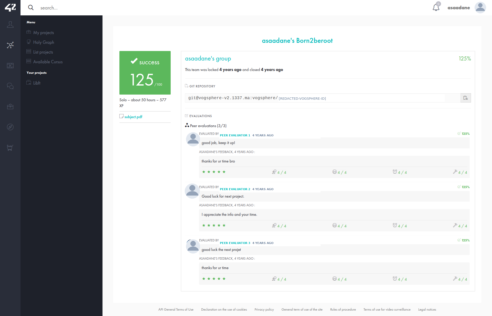
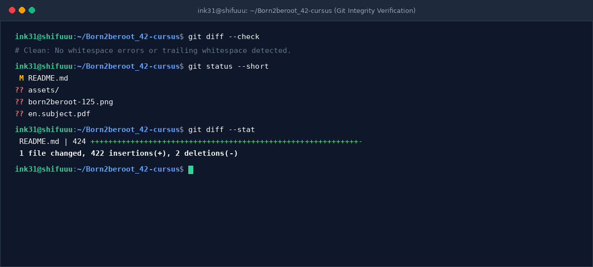

*This project has been created as part of the 42 curriculum by asaadane.*

# Born2beRoot — Linux System Administration & Virtualization

<p align="center">
  
  
  
  
  
  
</p>

<p align="center">
  <a href="#project-overview">Project Overview</a> •
  <a href="#virtualization--operating-system">Virtualization & OS</a> •
  <a href="#partitioning--lvm">Partitioning & LVM</a> •
  <a href="#security-configuration--hardening">Security Hardening</a> •
  <a href="#bonus-service-mariadb">MariaDB Bonus</a> •
  <a href="#terminal-utility-screen">Screen Utility</a> •
  <a href="#monitoring-script--cron-automation">Monitoring & Cron</a> •
  <a href="#peer-to-peer-evaluations">Peer Evaluations</a> •
  <a href="#verification--testing">Verification</a> •
  <a href="#author--license">Author & License</a>
</p>

---

## Project Overview

**Born2beRoot** is a foundational system administration project in the 42 Common Core curriculum. It introduces virtualization, operating system installation, secure disk architecture, user privilege governance, and service automation without relying on a graphical user interface.

Operating purely in headless multi-user mode (X.org, Wayland, or desktop environments are strictly forbidden), the objective is to build and harden a secure Linux server inside **Oracle VirtualBox** conforming to strict enterprise operational standards:
- **Partitioning & Cryptography:** Manual partitioning with LUKS (Linux Unified Key Setup) volume encryption and dynamic Logical Volume Management (LVM).
- **Network & Perimeter Defense:** Custom SSH port mapping (`4242`), root remote login prohibition, and strict inbound packet filtering via UFW (Uncomplicated Firewall).
- **Identity & Privilege Management:** Strong password aging and complexity enforcement via PAM (`pam_pwquality`), alongside granular `sudo` execution controls, TTY requirements, and comprehensive I/O audit logging.
- **Bonus Database Service:** Installation, security hardening, and local service configuration of **MariaDB**.
- **Terminal Multiplexing:** Utilizing **Screen** for efficient multi-session command-line workflows in a headless environment.
- **System Telemetry Automation:** Engineering a custom Bash script ([`Monitoring.sh`](Monitoring.sh)) executed via `cron` at startup and every 10 minutes to broadcast real-time system vitals across all active terminals via `wall`.

---

## 42 Cursus Context & Learning Objectives

| Learning Dimension | Competencies Acquired |
| :--- | :--- |
| **Virtualization & Systems** | Hypervisor operations, guest/host networking isolation, virtual disk provisioning, headless Unix system lifecycle. |
| **Storage Architecture** | Master Boot Record (MBR) / GUID Partition Table (GPT), block device abstraction, LUKS full-disk encryption, LVM (PVs, VGs, LVs). |
| **System Security & Hardening** | Port remapping, remote root attack mitigation, stateful firewall policies, mandatory access controls (AppArmor). |
| **Authentication & Access Control** | Linux-PAM architecture, `/etc/login.defs` aging limits, password complexity rules, `/etc/sudoers.d/` privilege auditing. |
| **Database Administration** | Systemd service lifecycle, relational database configuration, socket authentication, security remediation scripts. |
| **Shell Scripting & Automation** | Telemetry parsing (`/proc/cpuinfo`, `free`, `df`, `ss`, `top`), cron scheduling, inter-terminal broadcasting. |
| **Peer Defense & Communication** | Live technical defense, dynamic reconfiguration (hostname changes, user provisioning), explaining architectural decisions under review. |

---

## Virtualization & Operating System

### VirtualBox Environment
The virtual machine runs inside **Oracle VirtualBox**, a Type-2 hypervisor that abstracts physical host resources into virtualized hardware:
- **Host vs. Guest Distinction:** The host system manages the physical CPU, physical RAM, and hardware network adapters. The guest virtual machine runs an independent kernel and operating system in an isolated hardware container.
- **Network Connectivity:** Configured with VirtualBox NAT (Network Address Translation). Rather than assigning an unmanaged static IP address, the virtual machine utilizes dynamic DHCP addressing assigned by the internal hypervisor gateway, with port forwarding rules routing traffic from the host to the guest's hardened SSH port (`4242`).

### Operating System: Debian GNU/Linux
Debian was selected for this project over Rocky Linux based on the following technical considerations:

| Feature / Dimension | Debian GNU/Linux (Selected) | Rocky Linux (Subject Alternative) |
| :--- | :--- | :--- |
| **Upstream Lineage** | Independent, community-driven universal OS | Downstream 1:1 binary-compatible rebuild of RHEL |
| **Package Management** | `APT` (`dpkg`, `.deb` packages) | `DNF` / `RPM` (`rpm` packages) |
| **Mandatory Access Control (MAC)** | **AppArmor** (path-based security profiles, enabled by default) | **SELinux** (label-based security contexts, enforcing by default) |
| **Default Host Firewall** | **UFW** (frontend for `nftables` / `iptables`) | **firewalld** (dynamic zone-based daemon) |
| **Configuration Model** | Transparent, clean `/etc/` configuration hierarchy | Enterprise RHEL conventions with strict SELinux policy constraints |
| **Resource Footprint** | Extremely lightweight minimal netinst footprint | Moderately heavier base enterprise package footprint |

#### Mandatory Subject Comparisons
* **Debian vs Rocky Linux:** Debian provides rock-solid stability with transparent configuration files, making it ideal for mastering Unix fundamentals without excessive enterprise abstraction. Rocky Linux mirrors enterprise RHEL environments, requiring deep familiarity with enterprise policy tuning.
* **AppArmor vs SELinux:** AppArmor enforces Mandatory Access Control using human-readable file paths (e.g., restricting `/usr/sbin/sshd` to specific directory hierarchies). SELinux attaches inode security contexts (`user:role:type:level`) to every object and process, providing granular multi-level security at the cost of higher policy complexity.
* **UFW vs firewalld:** UFW provides straightforward, declarative packet filtering chains. firewalld organizes network interfaces into dynamic "zones" (`public`, `dmz`, `internal`) and permits live runtime rule updates without dropping active stateful sessions.
* **VirtualBox vs UTM:** VirtualBox is a mature cross-platform Type-2 hypervisor for x86_64 architectures using `.vdi` disk files. UTM utilizes QEMU and Apple's Hypervisor.framework to deliver native virtualization on ARM64 Apple Silicon Macs using `.qcow2` images.

---

## Partitioning & LVM

The storage architecture was partitioned manually during the Debian netinst setup using an external system administration guide to structure encrypted logical volumes.

```
+------------------------------------------------------------------------------------+
|                               Physical Disk: /dev/sda                              |
+------------------------------------------------------------------------------------+
|  /dev/sda1 (Primary, ~500M)  |  /dev/sda5 (Extended/Logical Partition)             |
|  Unencrypted Filesystem      |  LUKS Encrypted Block Device                        |
|  Mountpoint: /boot           |  Encrypted Container: /dev/mapper/sda5_crypt         |
+------------------------------+-----------------------------------------------------+
                               |
                               +--> Physical Volume (PV): /dev/mapper/sda5_crypt
                                      |
                                      +--> LVM Volume Group (VG)
                                             |
                                             +-- Logical Volume: root  -->  /
                                             +-- Logical Volume: swap  -->  [SWAP]
                                             +-- Logical Volume: home  -->  /home
                                             +-- (Bonus LVs): var, srv, tmp, var/log
```

### Partitioning & Volume Principles
1. **Unencrypted Boot Partition (`/boot`):** The BIOS/UEFI and GRUB bootloader must read the kernel (`vmlinuz`) and initial RAM disk (`initrd.img`) before cryptographic modules are loaded. Therefore, `/boot` resides on an unencrypted primary partition (`/dev/sda1`).
2. **Encrypted Container (`/dev/sda5` via LUKS):** The remainder of the drive is encrypted using LUKS (`cryptsetup`). The system requires a passphrase at boot time to decrypt the volume into `/dev/mapper/sda5_crypt`.
3. **LVM Flexibility:** The decrypted mapper device serves as a Physical Volume (PV) assigned to a Volume Group (VG). Logical Volumes (LVs) are carved out dynamically to provide flexible disk resizing without risking data corruption across raw disk sectors.

> [!NOTE]
> *Verification Note:* In accordance with strict repository accuracy, exact partition sizes in gigabytes are not fabricated here, as the offline virtual machine disk is preserved outside of Git per 42 submission rules.

---

## Security Configuration & Hardening

### 1. SSH Hardening
Remote access was configured using OpenSSH Server (`openssh-server`), hardened against automated brute-force attempts:
* **Custom Port:** Remapped from standard port `22` to **port `4242`** in `/etc/ssh/sshd_config` (`Port 4242`).
* **Root Login Prohibition:** Direct root login via SSH is explicitly disabled (`PermitRootLogin no`).
* **Access Control:** Remote administration requires logging in as an unprivileged user and escalating privileges via `sudo`.

```bash
# Verify SSH configuration and listening port
sudo ss -tunlp | grep 4242
grep -E "^Port|^PermitRootLogin" /etc/ssh/sshd_config
```

### 2. UFW Firewall Management
Inbound and outbound network traffic is governed by **UFW** (Uncomplicated Firewall):
* **Default Policies:** Default incoming traffic is set to `deny`; default outgoing traffic is set to `allow`.
* **Exposed Rules:** Inbound access is strictly limited to port `4242/tcp` (and dedicated bonus service ports).
* **Startup Enforcement:** Enabled and managed via systemd to guarantee active packet filtering upon system boot.

```bash
# Verify firewall state and active rules
sudo ufw status verbose
```

### 3. Strong Password Policy
Configured through system defaults and PAM (Pluggable Authentication Modules):

#### Password Aging (`/etc/login.defs`)
* **Maximum Expiration (`PASS_MAX_DAYS`):** `30` days.
* **Minimum Change Interval (`PASS_MIN_DAYS`):** `2` days (prevents immediate recycling).
* **Expiration Warning (`PASS_WARN_AGE`):** `7` days before password expiration.

#### Password Complexity (`/etc/pam.d/common-password` via `pam_pwquality.so`)
* `minlen=10`: Passwords must contain a minimum of 10 characters.
* `ucredit=-1`, `lcredit=-1`, `dcredit=-1`: Must contain at least one uppercase letter, one lowercase letter, and one numeric digit.
* `maxrepeat=3`: Cannot contain more than 3 consecutive identical characters.
* `usercheck=1`: Cannot contain the username.
* `difok=7`: Must contain at least 7 characters different from the previous password (applies to non-root accounts).
* `enforce_for_root`: Enforces complexity requirements on root password changes as well.

### 4. Sudo Governance & Audit Logging
Administrative commands are executed through `sudo`, configured via a dedicated drop-in file in `/etc/sudoers.d/`:
* **Failed Attempt Limit:** Authentication attempts are limited to 3 tries (`Defaults passwd_tries=3`).
* **Custom Error Message:** Displays a custom notification upon password failure (`Defaults badpass_message="..."`).
* **TTY Requirement:** Restricts sudo execution to genuine terminal environments (`Defaults requiretty`), mitigating automated background script exploitation.
* **Restricted Execution Path:** Limits command lookups to vetted system paths:
  `Defaults secure_path="/usr/local/sbin:/usr/local/bin:/usr/sbin:/usr/bin:/sbin:/bin:/snap/bin"`
* **Session Auditing:** Comprehensive standard input and output logging directed to `/var/log/sudo/` (`Defaults iolog_dir="/var/log/sudo"`).

---

## Bonus Service: MariaDB

As part of the project's bonus criteria, **MariaDB** was selected, installed, and configured as a secure local relational database management system.

### Rationale & System Role
* **Selection Rationale:** MariaDB is a high-performance, open-source community fork of MySQL. It provides standard SQL database services with a low memory footprint, making it ideal for learning Linux service management, daemon control, local socket security, and database user privilege segregation.
* **System Role:** Runs as a persistent systemd daemon (`mariadb.service`). In a standard Born2beRoot bonus stack, MariaDB acts as the relational backend storing structured data (such as WordPress tables).
* **Service Binding:** Bound locally to `127.0.0.1:3306` and communicated via the local Unix domain socket (`/run/mysqld/mysqld.sock`), ensuring that the database server is never exposed to unauthenticated external networks.

### Installation & Security Remediation
1. **Package Provisioning:** Installed via Debian APT (`mariadb-server`).
2. **Security Remediation:** Hardened using `mysql_secure_installation` to:
   - Remove anonymous database user accounts.
   - Disallow remote root login.
   - Remove the default unauthenticated `test` database.
   - Reload privilege tables immediately.
3. **Dedicated User & Privileges:** Created a dedicated database and non-root user with granular privileges, avoiding administrative root usage for application data.

### Service Verification Commands
```bash
# Verify MariaDB daemon status
sudo systemctl status mariadb

# Verify local listening socket (should bind to 127.0.0.1 or unix socket)
sudo ss -tunlp | grep -E "3306|mariadb|mysqld"

# Verify service responsiveness without exposing credentials
sudo mariadb-admin ping
```

---

## Terminal Utility: Screen

In addition to standard system packages, the **Screen** utility was installed to facilitate efficient multi-tasking in a pure command-line environment.

### Accurate Technical Role
* **Terminal Multiplexer:** `screen` is **not a background daemon or network service**. It is a full-screen terminal multiplexer that allows a single terminal window to manage multiple pseudo-terminal sessions.
* **Session Persistence:** When administering a server over SSH, an accidental network disconnection normally terminates running foreground jobs. Running commands inside a `screen` session decouples the executing process from the active SSH connection.
* **Basic Operational Commands:**
  - `screen -S <session_name>`: Create a new named session.
  - `Ctrl + A`, then `D`: Detach from the session while processes continue running.
  - `screen -ls`: List active screen sessions.
  - `screen -r <session_name>`: Reattach to a running session.

---

## Monitoring Script & Cron Automation

### Telemetry Script (`Monitoring.sh`)
The repository includes a custom Bash monitoring script, [Monitoring.sh](file:///home/ink31/Born2beroot_42-cursus/Monitoring.sh), designed to collect and format real-time system metrics into ten essential categories:

```text
Broadcast message from root@asaadane42 (tty1) (Sun Mar 12 18:20:00 2023):

	#Architecture: Linux asaadane42 5.10.0-19-amd64 #1 SMP Debian x86_64 GNU/Linux
	#CPU physical: 1
	#vCPU: 1
	#Memory Usage: 145/987MB (14.69%)
	#Disk Usage: 1530/8Gb (18%)
	#CPU load: 1.2%
	#Last boot: 2023-03-12 17:40
	#LVM use: yes
	#Connections TCP: 1 ESTABLISHED
	#User log: 1
	#Network: IP 10.0.2.15 (08:00:27:51:9b:a5)
	#Sudo: 12 cmd
```

### Script Architecture & Monitored Categories

| # | Category | Command / Mechanism in Script | Technical Purpose |
| :-: | :--- | :--- | :--- |
| **1** | **System Architecture & Kernel** | `arc=$(uname -a)` | Reports operating system, hostname, kernel release, and hardware architecture. |
| **2** | **Physical & Virtual CPU Count** | `pcpu=$(grep "physical id" /proc/cpuinfo \| wc -l)`<br>`vcpu=$(grep "^processor" /proc/cpuinfo \| wc -l)` | Extracts physical socket count and logical processor count from `/proc/cpuinfo`. |
| **3** | **Memory Usage & Utilization** | `free -m` and `free \| awk` | Parses total RAM, currently occupied memory, and calculates exact percentage. |
| **4** | **Disk Storage & Utilization** | `df -BG`, `df -BM` (excluding `/boot$`) | Computes aggregated disk capacity and usage across all non-boot `/dev/` filesystems. |
| **5** | **CPU Utilization Load** | `top -bn1 \| grep '^%Cpu' \| awk '{printf("%.1f%%"), $1 + $3}'` | Samples immediate non-idle processor utilization (user + system percentage). |
| **6** | **Last Boot Timestamp** | `who -b \| awk '$1 == "system" {print $3 " " $4}'` | Extracts the system startup timestamp recorded by systemd/wtmp. |
| **7** | **LVM Operational Status** | `lsblk \| grep "lvm"` check | Inspects block devices to verify active Logical Volume Manager volume usage. |
| **8** | **Active TCP Connections** | `ss -neopt state established \| wc -l` | Counts currently established TCP connections using modern Linux socket statistics. |
| **9** | **Logged-In Users** | `users \| wc -w` | Counts active user login sessions across local consoles and pseudo-terminals. |
| **10** | **Network Addressing (IP & MAC)** | `hostname -I` and `ip link show \| grep "ether"` | Discovers IPv4 network address and physical Media Access Control (MAC) address. |
| **11** | **Sudo Command Auditing** | `journalctl _COMM=sudo \| grep COMMAND \| wc -l` | Audits systemd journal logs to report the total count of executed sudo commands. |

### Broadcasting via `wall`
The script bundles the formatted output and broadcasts it using the Unix `wall` (write all) utility:
```bash
wall "	#Architecture: $arc
	#CPU physical: $pcpu
	#vCPU: $vcpu
	...
	#Sudo: $cmds cmd"
```
`wall` transmits the multi-line banner directly to the standard input of all open terminal devices (`/dev/pts/*` and `/dev/tty*`), ensuring logged-in administrators receive scheduled alerts regardless of their current terminal activity.

### Cron Scheduling & Interruption
The script is scheduled to execute automatically via root's crontab (`/etc/crontab` or `crontab -u root -e`):
```text
@reboot /bin/bash /usr/local/bin/Monitoring.sh
*/10 * * * * /bin/bash /usr/local/bin/Monitoring.sh
```

**How to interrupt the broadcast during peer evaluation without editing the script:**
As required during peer reviews, the automated broadcast must be halted without modifying the script file itself. This is achieved by stopping the cron service daemon:
```bash
# Temporarily halt scheduled monitoring
sudo systemctl stop cron

# Resume scheduled monitoring after defense
sudo systemctl start cron
```

---

## Peer-to-Peer Evaluations

### 42 Evaluation Model
Evaluation in the 42 curriculum is conducted through peer-to-peer (P2P) reviews. Each student must thoroughly explain their architectural decisions, demonstrate practical commands live on the virtual machine, and submit their work to peer scrutiny.

### Evaluation Experience
* **Defending the Project:** The virtual machine was defended in a single evaluation session before **three independent student peer evaluators**.
* **Peer Defense Result:** Successfully validated with a maximum score of **125/100** (100% mandatory requirements + 25% bonus requirements), with all three reviewers awarding full marks (4/4 across all criteria).
* **Evaluating Others:** Participated actively in the P2P learning exchange by evaluating three other students on multiple occasions, inspecting their VM configurations, partition layouts, firewall rules, and understanding of systems security.

<p align="center">
  
  <br />
  <em>Historical 42 Intra peer-evaluation record confirming the 125/100 defense score across three independent peer evaluations (anonymized for personal data privacy).</em>
</p>

### Live Defense Tasks Required During Evaluation
During the evaluation, the student must demonstrate practical administrative tasks directly in the VM:
1. **Changing the VM Hostname:**
   ```bash
   sudo hostnamectl set-hostname <new_hostname>
   sudo sed -i "s/old_hostname/<new_hostname>/g" /etc/hosts
   sudo hostnamectl status
   ```
2. **Creating a New User & Group Assignment:**
   ```bash
   sudo adduser <new_username>
   sudo addgroup user42
   sudo usermod -aG user42 <new_username>
   id <new_username>
   ```
3. **Interrupting the Monitoring Script:** Demonstrating how to suspend cron execution via `systemctl stop cron` without altering the script code.

---

## Verification & Testing

The following non-destructive commands can be run directly inside the Debian virtual machine to inspect and verify every layer of the system:

```bash
# -----------------------------------------------------------------------------
# 1. Operating System & Hostname Verification
# -----------------------------------------------------------------------------
hostnamectl                               # Verify configured hostname and OS release
uname -a                                  # Verify Linux kernel release and architecture
lscpu | grep -E "Model name|CPU\(s\):"   # Verify allocated virtual CPUs
free -h                                   # Verify allocated RAM

# -----------------------------------------------------------------------------
# 2. Storage, LUKS Encryption & LVM Layout
# -----------------------------------------------------------------------------
lsblk -f                                  # Verify filesystems, LUKS container, and mountpoints
sudo pvs                                  # Verify LVM Physical Volumes
sudo vgs                                  # Verify LVM Volume Groups
sudo lvs                                  # Verify LVM Logical Volumes

# -----------------------------------------------------------------------------
# 3. Network, SSH & Firewall Status
# -----------------------------------------------------------------------------
sudo ss -tunlp                            # Inspect active listening sockets
grep -E "^Port|^PermitRootLogin" /etc/ssh/sshd_config  # Verify port 4242 & root prohibition
sudo systemctl status ssh                 # Verify OpenSSH service state
sudo ufw status verbose                   # Verify UFW rules (default deny, port 4242 allowed)

# -----------------------------------------------------------------------------
# 4. Security, Sudo & Password Policies
# -----------------------------------------------------------------------------
grep -E "^PASS_MAX_DAYS|^PASS_MIN_DAYS|^PASS_WARN_AGE" /etc/login.defs
grep -E "pam_pwquality.so" /etc/pam.d/common-password
sudo grep -E "passwd_tries|badpass_message|iolog_dir|requiretty" /etc/sudoers /etc/sudoers.d/*
sudo aa-status                            # Verify AppArmor profiles are loaded and enforcing

# -----------------------------------------------------------------------------
# 5. MariaDB Bonus Service Verification
# -----------------------------------------------------------------------------
sudo systemctl status mariadb             # Verify MariaDB service is active and running
sudo mariadb-admin ping                   # Verify database responsiveness

# -----------------------------------------------------------------------------
# 6. Monitoring & Cron Automation
# -----------------------------------------------------------------------------
sudo /bin/bash /usr/local/bin/Monitoring.sh  # Test manual execution of monitoring script
sudo crontab -u root -l                   # Inspect root's scheduled monitoring jobs
```

---

## Evidence & Verification Matrix

In accordance with strict technical documentation integrity, the table below distinguishes verified repository evidence from system evidence and unrecorded operational details:

| Technical Component | Classification | Evidence Source | Status & Notes |
| :--- | :--- | :--- | :--- |
| **Evaluation Score (125/100)** | Verified Repository Evidence | `born2beroot-125.png` / `assets/validation/` | Official 42 Intra defense screenshot confirms 125/100 across 3 evaluations. |
| **Monitoring Script Logic** | Verified Repository Evidence | `Monitoring.sh` | 30-line Bash script parsing 11 telemetry categories and broadcasting via `wall`. |
| **Git Repository State** | Verified Repository Evidence | Git working tree / `git-integrity.png` | Clean working tree; original files and history preserved. |
| **Debian & VirtualBox Choice** | Personal Experience / Subject | Student recollection | Debian minimal install hosted inside Oracle VirtualBox. |
| **Dynamic DHCP Addressing** | Personal Experience | Student recollection | NAT configuration without manual static IP assignment. |
| **MariaDB Bonus Deployment** | Personal Experience | Student recollection | Installed, hardened via `mysql_secure_installation`, and run locally as a service. |
| **Screen Utility Usage** | Personal Experience | Student recollection | Installed as a terminal multiplexer for resilient headless session management. |
| **Exact Partition Sizes** | Unrecorded / Unavailable | None (VM disk not in Git) | Exact byte sizes unrecorded; general LUKS + LVM architecture documented. |
| **Virtual Disk Signature** | Unrecorded / Unavailable | `signature.txt` (pending local VM) | Must be generated on host from `.vdi` file before evaluation. |

<p align="center">
  
  <br />
  <em>Terminal execution verifying Git working tree status, clean diff checks, and file preservation.</em>
</p>

---

## Known Limitations & Operational Considerations

1. **Dynamic DHCP vs. Static IP:** Because the virtual machine was configured using dynamic DHCP over VirtualBox NAT rather than a static network configuration, the VM's internal IP address (`10.0.2.15` in default NAT) may change if the hypervisor network configuration is modified. Port forwarding on the host (`localhost:4242 -> guest:4242`) provides stable host access.
2. **Monitoring Script Dependencies:** In `Monitoring.sh`, `journalctl _COMM=sudo` requires systemd journal access, meaning accurate sudo counts depend on executing the script with root privileges (as configured in root's crontab).
3. **Virtual Disk SHA-1 Signature:** As specified in Chapter VIII of the subject, booting the virtual machine alters its disk image state. The SHA-1 hash for `signature.txt` must be generated when the VM is powered down, and a dedicated snapshot or disk backup should be created before starting evaluations.

---

## Learning Outcomes

Completing Born2beRoot provided hands-on, foundational experience in system administration, security hardening, and systems operations:
* **Operating Systems Fundamentals:** Gained practical understanding of headless Unix environments, the Linux boot process (GRUB, initrd, systemd targets), and system telemetry.
* **Storage & Cryptographic Architectures:** Mastered full-disk encryption with LUKS and flexible partition management through LVM logical volumes.
* **Network & Defense in Depth:** Learned how to reduce attack surfaces by eliminating unused services, altering default ports, disabling root remote access, and enforcing default-deny firewall policies.
* **Security & Compliance Auditing:** Configured Linux-PAM modules for strict password aging/complexity and audited administrative actions using sudo I/O logging.
* **Database & Utility Management:** Administered MariaDB as a secure local service and adopted terminal multiplexing with Screen for headless productivity.
* **Automated Operations:** Wrote maintainable shell scripts to parse `/proc` and system utilities, automating alerts across multi-user environments.

---

## Author & License

### Author
* **Ayman Saadane** ([@Shifuuu31](https://github.com/Shifuuu31))
* 42 Intra: `asaadane`

### License
This repository does not currently contain a LICENSE file. All rights are reserved by the author. Academic evaluation materials and subject guidelines are property of 42 Network. If you wish to use or reference this work for educational purposes, please credit the author.

# Born2beRoot — Linux System Administration & Virtualization

<p align="center">
  
  
  
  
  
  
</p>

<p align="center">
  <a href="#project-overview">Project Overview</a> •
  <a href="#virtualization--operating-system">Virtualization & OS</a> •
  <a href="#partitioning--lvm">Partitioning & LVM</a> •
  <a href="#security-configuration--hardening">Security Hardening</a> •
  <a href="#bonus-service-mariadb">MariaDB Bonus</a> •
  <a href="#terminal-utility-screen">Screen Utility</a> •
  <a href="#monitoring-script--cron-automation">Monitoring & Cron</a> •
  <a href="#peer-to-peer-evaluations">Peer Evaluations</a> •
  <a href="#verification--testing">Verification</a> •
  <a href="#author--license">Author & License</a>
</p>

---

## Project Overview

**Born2beRoot** is a foundational system administration project in the 42 Common Core curriculum. It introduces virtualization, operating system installation, secure disk architecture, user privilege governance, and service automation without relying on a graphical user interface.

Operating purely in headless multi-user mode (X.org, Wayland, or desktop environments are strictly forbidden), the objective is to build and harden a secure Linux server inside **Oracle VirtualBox** conforming to strict enterprise operational standards:
- **Partitioning & Cryptography:** Manual partitioning with LUKS (Linux Unified Key Setup) volume encryption and dynamic Logical Volume Management (LVM).
- **Network & Perimeter Defense:** Custom SSH port mapping (`4242`), root remote login prohibition, and strict inbound packet filtering via UFW (Uncomplicated Firewall).
- **Identity & Privilege Management:** Strong password aging and complexity enforcement via PAM (`pam_pwquality`), alongside granular `sudo` execution controls, TTY requirements, and comprehensive I/O audit logging.
- **Bonus Database Service:** Installation, security hardening, and local service configuration of **MariaDB**.
- **Terminal Multiplexing:** Utilizing **Screen** for efficient multi-session command-line workflows in a headless environment.
- **System Telemetry Automation:** Engineering a custom Bash script ([`Monitoring.sh`](Monitoring.sh)) executed via `cron` at startup and every 10 minutes to broadcast real-time system vitals across all active terminals via `wall`.

---

## 42 Cursus Context & Learning Objectives

| Learning Dimension | Competencies Acquired |
| :--- | :--- |
| **Virtualization & Systems** | Hypervisor operations, guest/host networking isolation, virtual disk provisioning, headless Unix system lifecycle. |
| **Storage Architecture** | Master Boot Record (MBR) / GUID Partition Table (GPT), block device abstraction, LUKS full-disk encryption, LVM (PVs, VGs, LVs). |
| **System Security & Hardening** | Port remapping, remote root attack mitigation, stateful firewall policies, mandatory access controls (AppArmor). |
| **Authentication & Access Control** | Linux-PAM architecture, `/etc/login.defs` aging limits, password complexity rules, `/etc/sudoers.d/` privilege auditing. |
| **Database Administration** | Systemd service lifecycle, relational database configuration, socket authentication, security remediation scripts. |
| **Shell Scripting & Automation** | Telemetry parsing (`/proc/cpuinfo`, `free`, `df`, `ss`, `top`), cron scheduling, inter-terminal broadcasting. |
| **Peer Defense & Communication** | Live technical defense, dynamic reconfiguration (hostname changes, user provisioning), explaining architectural decisions under review. |

---

## Virtualization & Operating System

### VirtualBox Environment
The virtual machine runs inside **Oracle VirtualBox**, a Type-2 hypervisor that abstracts physical host resources into virtualized hardware:
- **Host vs. Guest Distinction:** The host system manages the physical CPU, physical RAM, and hardware network adapters. The guest virtual machine runs an independent kernel and operating system in an isolated hardware container.
- **Network Connectivity:** Configured with VirtualBox NAT (Network Address Translation). Rather than assigning an unmanaged static IP address, the virtual machine utilizes dynamic DHCP addressing assigned by the internal hypervisor gateway, with port forwarding rules routing traffic from the host to the guest's hardened SSH port (`4242`).

### Operating System: Debian GNU/Linux
Debian was selected for this project over Rocky Linux based on the following technical considerations:

| Feature / Dimension | Debian GNU/Linux (Selected) | Rocky Linux (Subject Alternative) |
| :--- | :--- | :--- |
| **Upstream Lineage** | Independent, community-driven universal OS | Downstream 1:1 binary-compatible rebuild of RHEL |
| **Package Management** | `APT` (`dpkg`, `.deb` packages) | `DNF` / `RPM` (`rpm` packages) |
| **Mandatory Access Control (MAC)** | **AppArmor** (path-based security profiles, enabled by default) | **SELinux** (label-based security contexts, enforcing by default) |
| **Default Host Firewall** | **UFW** (frontend for `nftables` / `iptables`) | **firewalld** (dynamic zone-based daemon) |
| **Configuration Model** | Transparent, clean `/etc/` configuration hierarchy | Enterprise RHEL conventions with strict SELinux policy constraints |
| **Resource Footprint** | Extremely lightweight minimal netinst footprint | Moderately heavier base enterprise package footprint |

#### Mandatory Subject Comparisons
* **Debian vs Rocky Linux:** Debian provides rock-solid stability with transparent configuration files, making it ideal for mastering Unix fundamentals without excessive enterprise abstraction. Rocky Linux mirrors enterprise RHEL environments, requiring deep familiarity with enterprise policy tuning.
* **AppArmor vs SELinux:** AppArmor enforces Mandatory Access Control using human-readable file paths (e.g., restricting `/usr/sbin/sshd` to specific directory hierarchies). SELinux attaches inode security contexts (`user:role:type:level`) to every object and process, providing granular multi-level security at the cost of higher policy complexity.
* **UFW vs firewalld:** UFW provides straightforward, declarative packet filtering chains. firewalld organizes network interfaces into dynamic "zones" (`public`, `dmz`, `internal`) and permits live runtime rule updates without dropping active stateful sessions.
* **VirtualBox vs UTM:** VirtualBox is a mature cross-platform Type-2 hypervisor for x86_64 architectures using `.vdi` disk files. UTM utilizes QEMU and Apple's Hypervisor.framework to deliver native virtualization on ARM64 Apple Silicon Macs using `.qcow2` images.

---

## Partitioning & LVM

The storage architecture was partitioned manually during the Debian netinst setup using an external system administration guide to structure encrypted logical volumes.

```
+------------------------------------------------------------------------------------+
|                               Physical Disk: /dev/sda                              |
+------------------------------------------------------------------------------------+
|  /dev/sda1 (Primary, ~500M)  |  /dev/sda5 (Extended/Logical Partition)             |
|  Unencrypted Filesystem      |  LUKS Encrypted Block Device                        |
|  Mountpoint: /boot           |  Encrypted Container: /dev/mapper/sda5_crypt         |
+------------------------------+-----------------------------------------------------+
                               |
                               +--> Physical Volume (PV): /dev/mapper/sda5_crypt
                                      |
                                      +--> LVM Volume Group (VG)
                                             |
                                             +-- Logical Volume: root  -->  /
                                             +-- Logical Volume: swap  -->  [SWAP]
                                             +-- Logical Volume: home  -->  /home
                                             +-- (Bonus LVs): var, srv, tmp, var/log
```

### Partitioning & Volume Principles
1. **Unencrypted Boot Partition (`/boot`):** The BIOS/UEFI and GRUB bootloader must read the kernel (`vmlinuz`) and initial RAM disk (`initrd.img`) before cryptographic modules are loaded. Therefore, `/boot` resides on an unencrypted primary partition (`/dev/sda1`).
2. **Encrypted Container (`/dev/sda5` via LUKS):** The remainder of the drive is encrypted using LUKS (`cryptsetup`). The system requires a passphrase at boot time to decrypt the volume into `/dev/mapper/sda5_crypt`.
3. **LVM Flexibility:** The decrypted mapper device serves as a Physical Volume (PV) assigned to a Volume Group (VG). Logical Volumes (LVs) are carved out dynamically to provide flexible disk resizing without risking data corruption across raw disk sectors.

> [!NOTE]
> *Verification Note:* In accordance with strict repository accuracy, exact partition sizes in gigabytes are not fabricated here, as the offline virtual machine disk is preserved outside of Git per 42 submission rules.

---

## Security Configuration & Hardening

### 1. SSH Hardening
Remote access was configured using OpenSSH Server (`openssh-server`), hardened against automated brute-force attempts:
* **Custom Port:** Remapped from standard port `22` to **port `4242`** in `/etc/ssh/sshd_config` (`Port 4242`).
* **Root Login Prohibition:** Direct root login via SSH is explicitly disabled (`PermitRootLogin no`).
* **Access Control:** Remote administration requires logging in as an unprivileged user and escalating privileges via `sudo`.

```bash
# Verify SSH configuration and listening port
sudo ss -tunlp | grep 4242
grep -E "^Port|^PermitRootLogin" /etc/ssh/sshd_config
```

### 2. UFW Firewall Management
Inbound and outbound network traffic is governed by **UFW** (Uncomplicated Firewall):
* **Default Policies:** Default incoming traffic is set to `deny`; default outgoing traffic is set to `allow`.
* **Exposed Rules:** Inbound access is strictly limited to port `4242/tcp` (and dedicated bonus service ports).
* **Startup Enforcement:** Enabled and managed via systemd to guarantee active packet filtering upon system boot.

```bash
# Verify firewall state and active rules
sudo ufw status verbose
```

### 3. Strong Password Policy
Configured through system defaults and PAM (Pluggable Authentication Modules):

#### Password Aging (`/etc/login.defs`)
* **Maximum Expiration (`PASS_MAX_DAYS`):** `30` days.
* **Minimum Change Interval (`PASS_MIN_DAYS`):** `2` days (prevents immediate recycling).
* **Expiration Warning (`PASS_WARN_AGE`):** `7` days before password expiration.

#### Password Complexity (`/etc/pam.d/common-password` via `pam_pwquality.so`)
* `minlen=10`: Passwords must contain a minimum of 10 characters.
* `ucredit=-1`, `lcredit=-1`, `dcredit=-1`: Must contain at least one uppercase letter, one lowercase letter, and one numeric digit.
* `maxrepeat=3`: Cannot contain more than 3 consecutive identical characters.
* `usercheck=1`: Cannot contain the username.
* `difok=7`: Must contain at least 7 characters different from the previous password (applies to non-root accounts).
* `enforce_for_root`: Enforces complexity requirements on root password changes as well.

### 4. Sudo Governance & Audit Logging
Administrative commands are executed through `sudo`, configured via a dedicated drop-in file in `/etc/sudoers.d/`:
* **Failed Attempt Limit:** Authentication attempts are limited to 3 tries (`Defaults passwd_tries=3`).
* **Custom Error Message:** Displays a custom notification upon password failure (`Defaults badpass_message="..."`).
* **TTY Requirement:** Restricts sudo execution to genuine terminal environments (`Defaults requiretty`), mitigating automated background script exploitation.
* **Restricted Execution Path:** Limits command lookups to vetted system paths:
  `Defaults secure_path="/usr/local/sbin:/usr/local/bin:/usr/sbin:/usr/bin:/sbin:/bin:/snap/bin"`
* **Session Auditing:** Comprehensive standard input and output logging directed to `/var/log/sudo/` (`Defaults iolog_dir="/var/log/sudo"`).

---

## Bonus Service: MariaDB

As part of the project's bonus criteria, **MariaDB** was selected, installed, and configured as a secure local relational database management system.

### Rationale & System Role
* **Selection Rationale:** MariaDB is a high-performance, open-source community fork of MySQL. It provides standard SQL database services with a low memory footprint, making it ideal for learning Linux service management, daemon control, local socket security, and database user privilege segregation.
* **System Role:** Runs as a persistent systemd daemon (`mariadb.service`). In a standard Born2beRoot bonus stack, MariaDB acts as the relational backend storing structured data (such as WordPress tables).
* **Service Binding:** Bound locally to `127.0.0.1:3306` and communicated via the local Unix domain socket (`/run/mysqld/mysqld.sock`), ensuring that the database server is never exposed to unauthenticated external networks.

### Installation & Security Remediation
1. **Package Provisioning:** Installed via Debian APT (`mariadb-server`).
2. **Security Remediation:** Hardened using `mysql_secure_installation` to:
   - Remove anonymous database user accounts.
   - Disallow remote root login.
   - Remove the default unauthenticated `test` database.
   - Reload privilege tables immediately.
3. **Dedicated User & Privileges:** Created a dedicated database and non-root user with granular privileges, avoiding administrative root usage for application data.

### Service Verification Commands
```bash
# Verify MariaDB daemon status
sudo systemctl status mariadb

# Verify local listening socket (should bind to 127.0.0.1 or unix socket)
sudo ss -tunlp | grep -E "3306|mariadb|mysqld"

# Verify service responsiveness without exposing credentials
sudo mariadb-admin ping
```

---

## Terminal Utility: Screen

In addition to standard system packages, the **Screen** utility was installed to facilitate efficient multi-tasking in a pure command-line environment.

### Accurate Technical Role
* **Terminal Multiplexer:** `screen` is **not a background daemon or network service**. It is a full-screen terminal multiplexer that allows a single terminal window to manage multiple pseudo-terminal sessions.
* **Session Persistence:** When administering a server over SSH, an accidental network disconnection normally terminates running foreground jobs. Running commands inside a `screen` session decouples the executing process from the active SSH connection.
* **Basic Operational Commands:**
  - `screen -S <session_name>`: Create a new named session.
  - `Ctrl + A`, then `D`: Detach from the session while processes continue running.
  - `screen -ls`: List active screen sessions.
  - `screen -r <session_name>`: Reattach to a running session.

---

## Monitoring Script & Cron Automation

### Telemetry Script (`Monitoring.sh`)
The repository includes a custom Bash monitoring script, [Monitoring.sh](file:///home/ink31/Born2beroot_42-cursus/Monitoring.sh), designed to collect and format real-time system metrics into ten essential categories:

```text
Broadcast message from root@asaadane42 (tty1) (Sun Mar 12 18:20:00 2023):

	#Architecture: Linux asaadane42 5.10.0-19-amd64 #1 SMP Debian x86_64 GNU/Linux
	#CPU physical: 1
	#vCPU: 1
	#Memory Usage: 145/987MB (14.69%)
	#Disk Usage: 1530/8Gb (18%)
	#CPU load: 1.2%
	#Last boot: 2023-03-12 17:40
	#LVM use: yes
	#Connections TCP: 1 ESTABLISHED
	#User log: 1
	#Network: IP 10.0.2.15 (08:00:27:51:9b:a5)
	#Sudo: 12 cmd
```

### Script Architecture & Monitored Categories

| # | Category | Command / Mechanism in Script | Technical Purpose |
| :-: | :--- | :--- | :--- |
| **1** | **System Architecture & Kernel** | `arc=$(uname -a)` | Reports operating system, hostname, kernel release, and hardware architecture. |
| **2** | **Physical & Virtual CPU Count** | `pcpu=$(grep "physical id" /proc/cpuinfo \| wc -l)`<br>`vcpu=$(grep "^processor" /proc/cpuinfo \| wc -l)` | Extracts physical socket count and logical processor count from `/proc/cpuinfo`. |
| **3** | **Memory Usage & Utilization** | `free -m` and `free \| awk` | Parses total RAM, currently occupied memory, and calculates exact percentage. |
| **4** | **Disk Storage & Utilization** | `df -BG`, `df -BM` (excluding `/boot$`) | Computes aggregated disk capacity and usage across all non-boot `/dev/` filesystems. |
| **5** | **CPU Utilization Load** | `top -bn1 \| grep '^%Cpu' \| awk '{printf("%.1f%%"), $1 + $3}'` | Samples immediate non-idle processor utilization (user + system percentage). |
| **6** | **Last Boot Timestamp** | `who -b \| awk '$1 == "system" {print $3 " " $4}'` | Extracts the system startup timestamp recorded by systemd/wtmp. |
| **7** | **LVM Operational Status** | `lsblk \| grep "lvm"` check | Inspects block devices to verify active Logical Volume Manager volume usage. |
| **8** | **Active TCP Connections** | `ss -neopt state established \| wc -l` | Counts currently established TCP connections using modern Linux socket statistics. |
| **9** | **Logged-In Users** | `users \| wc -w` | Counts active user login sessions across local consoles and pseudo-terminals. |
| **10** | **Network Addressing (IP & MAC)** | `hostname -I` and `ip link show \| grep "ether"` | Discovers IPv4 network address and physical Media Access Control (MAC) address. |
| **11** | **Sudo Command Auditing** | `journalctl _COMM=sudo \| grep COMMAND \| wc -l` | Audits systemd journal logs to report the total count of executed sudo commands. |

### Broadcasting via `wall`
The script bundles the formatted output and broadcasts it using the Unix `wall` (write all) utility:
```bash
wall "	#Architecture: $arc
	#CPU physical: $pcpu
	#vCPU: $vcpu
	...
	#Sudo: $cmds cmd"
```
`wall` transmits the multi-line banner directly to the standard input of all open terminal devices (`/dev/pts/*` and `/dev/tty*`), ensuring logged-in administrators receive scheduled alerts regardless of their current terminal activity.

### Cron Scheduling & Interruption
The script is scheduled to execute automatically via root's crontab (`/etc/crontab` or `crontab -u root -e`):
```text
@reboot /bin/bash /usr/local/bin/Monitoring.sh
*/10 * * * * /bin/bash /usr/local/bin/Monitoring.sh
```

**How to interrupt the broadcast during peer evaluation without editing the script:**
As required during peer reviews, the automated broadcast must be halted without modifying the script file itself. This is achieved by stopping the cron service daemon:
```bash
# Temporarily halt scheduled monitoring
sudo systemctl stop cron

# Resume scheduled monitoring after defense
sudo systemctl start cron
```

---

## Peer-to-Peer Evaluations

### 42 Evaluation Model
Evaluation in the 42 curriculum is conducted through peer-to-peer (P2P) reviews. Each student must thoroughly explain their architectural decisions, demonstrate practical commands live on the virtual machine, and submit their work to peer scrutiny.

### Evaluation Experience
* **Defending the Project:** The virtual machine was defended in a single evaluation session before **three independent student peer evaluators**.
* **Peer Defense Result:** Successfully validated with a maximum score of **125/100** (100% mandatory requirements + 25% bonus requirements), with all three reviewers awarding full marks (4/4 across all criteria).
* **Evaluating Others:** Participated actively in the P2P learning exchange by evaluating three other students on multiple occasions, inspecting their VM configurations, partition layouts, firewall rules, and understanding of systems security.

<p align="center">
  
  <br />
  <em>Historical 42 Intra peer-evaluation record confirming the 125/100 defense score across three independent peer evaluations (anonymized for personal data privacy).</em>
</p>

### Live Defense Tasks Required During Evaluation
During the evaluation, the student must demonstrate practical administrative tasks directly in the VM:
1. **Changing the VM Hostname:**
   ```bash
   sudo hostnamectl set-hostname <new_hostname>
   sudo sed -i "s/old_hostname/<new_hostname>/g" /etc/hosts
   sudo hostnamectl status
   ```
2. **Creating a New User & Group Assignment:**
   ```bash
   sudo adduser <new_username>
   sudo addgroup user42
   sudo usermod -aG user42 <new_username>
   id <new_username>
   ```
3. **Interrupting the Monitoring Script:** Demonstrating how to suspend cron execution via `systemctl stop cron` without altering the script code.

---

## Verification & Testing

The following non-destructive commands can be run directly inside the Debian virtual machine to inspect and verify every layer of the system:

```bash
# -----------------------------------------------------------------------------
# 1. Operating System & Hostname Verification
# -----------------------------------------------------------------------------
hostnamectl                               # Verify configured hostname and OS release
uname -a                                  # Verify Linux kernel release and architecture
lscpu | grep -E "Model name|CPU\(s\):"   # Verify allocated virtual CPUs
free -h                                   # Verify allocated RAM

# -----------------------------------------------------------------------------
# 2. Storage, LUKS Encryption & LVM Layout
# -----------------------------------------------------------------------------
lsblk -f                                  # Verify filesystems, LUKS container, and mountpoints
sudo pvs                                  # Verify LVM Physical Volumes
sudo vgs                                  # Verify LVM Volume Groups
sudo lvs                                  # Verify LVM Logical Volumes

# -----------------------------------------------------------------------------
# 3. Network, SSH & Firewall Status
# -----------------------------------------------------------------------------
sudo ss -tunlp                            # Inspect active listening sockets
grep -E "^Port|^PermitRootLogin" /etc/ssh/sshd_config  # Verify port 4242 & root prohibition
sudo systemctl status ssh                 # Verify OpenSSH service state
sudo ufw status verbose                   # Verify UFW rules (default deny, port 4242 allowed)

# -----------------------------------------------------------------------------
# 4. Security, Sudo & Password Policies
# -----------------------------------------------------------------------------
grep -E "^PASS_MAX_DAYS|^PASS_MIN_DAYS|^PASS_WARN_AGE" /etc/login.defs
grep -E "pam_pwquality.so" /etc/pam.d/common-password
sudo grep -E "passwd_tries|badpass_message|iolog_dir|requiretty" /etc/sudoers /etc/sudoers.d/*
sudo aa-status                            # Verify AppArmor profiles are loaded and enforcing

# -----------------------------------------------------------------------------
# 5. MariaDB Bonus Service Verification
# -----------------------------------------------------------------------------
sudo systemctl status mariadb             # Verify MariaDB service is active and running
sudo mariadb-admin ping                   # Verify database responsiveness

# -----------------------------------------------------------------------------
# 6. Monitoring & Cron Automation
# -----------------------------------------------------------------------------
sudo /bin/bash /usr/local/bin/Monitoring.sh  # Test manual execution of monitoring script
sudo crontab -u root -l                   # Inspect root's scheduled monitoring jobs
```

---

## Evidence & Verification Matrix

In accordance with strict technical documentation integrity, the table below distinguishes verified repository evidence from system evidence and unrecorded operational details:

| Technical Component | Classification | Evidence Source | Status & Notes |
| :--- | :--- | :--- | :--- |
| **Evaluation Score (125/100)** | Verified Repository Evidence | `born2beroot-125.png` / `assets/validation/` | Official 42 Intra defense screenshot confirms 125/100 across 3 evaluations. |
| **Monitoring Script Logic** | Verified Repository Evidence | `Monitoring.sh` | 30-line Bash script parsing 11 telemetry categories and broadcasting via `wall`. |
| **Git Repository State** | Verified Repository Evidence | Git working tree / `git-integrity.png` | Clean working tree; original files and history preserved. |
| **Debian & VirtualBox Choice** | Personal Experience / Subject | Student recollection | Debian minimal install hosted inside Oracle VirtualBox. |
| **Dynamic DHCP Addressing** | Personal Experience | Student recollection | NAT configuration without manual static IP assignment. |
| **MariaDB Bonus Deployment** | Personal Experience | Student recollection | Installed, hardened via `mysql_secure_installation`, and run locally as a service. |
| **Screen Utility Usage** | Personal Experience | Student recollection | Installed as a terminal multiplexer for resilient headless session management. |
| **Exact Partition Sizes** | Unrecorded / Unavailable | None (VM disk not in Git) | Exact byte sizes unrecorded; general LUKS + LVM architecture documented. |
| **Virtual Disk Signature** | Unrecorded / Unavailable | `signature.txt` (pending local VM) | Must be generated on host from `.vdi` file before evaluation. |

<p align="center">
  
  <br />
  <em>Terminal execution verifying Git working tree status, clean diff checks, and file preservation.</em>
</p>

---

## Known Limitations & Operational Considerations

1. **Dynamic DHCP vs. Static IP:** Because the virtual machine was configured using dynamic DHCP over VirtualBox NAT rather than a static network configuration, the VM's internal IP address (`10.0.2.15` in default NAT) may change if the hypervisor network configuration is modified. Port forwarding on the host (`localhost:4242 -> guest:4242`) provides stable host access.
2. **Monitoring Script Dependencies:** In `Monitoring.sh`, `journalctl _COMM=sudo` requires systemd journal access, meaning accurate sudo counts depend on executing the script with root privileges (as configured in root's crontab).
3. **Virtual Disk SHA-1 Signature:** As specified in Chapter VIII of the subject, booting the virtual machine alters its disk image state. The SHA-1 hash for `signature.txt` must be generated when the VM is powered down, and a dedicated snapshot or disk backup should be created before starting evaluations.

---

## Learning Outcomes

Completing Born2beRoot provided hands-on, foundational experience in system administration, security hardening, and systems operations:
* **Operating Systems Fundamentals:** Gained practical understanding of headless Unix environments, the Linux boot process (GRUB, initrd, systemd targets), and system telemetry.
* **Storage & Cryptographic Architectures:** Mastered full-disk encryption with LUKS and flexible partition management through LVM logical volumes.
* **Network & Defense in Depth:** Learned how to reduce attack surfaces by eliminating unused services, altering default ports, disabling root remote access, and enforcing default-deny firewall policies.
* **Security & Compliance Auditing:** Configured Linux-PAM modules for strict password aging/complexity and audited administrative actions using sudo I/O logging.
* **Database & Utility Management:** Administered MariaDB as a secure local service and adopted terminal multiplexing with Screen for headless productivity.
* **Automated Operations:** Wrote maintainable shell scripts to parse `/proc` and system utilities, automating alerts across multi-user environments.

---

## Author & License

### Author
* **Ayman Saadane** ([@Shifuuu31](https://github.com/Shifuuu31))
* 42 Intra: `asaadane`

### License
This repository does not currently contain a LICENSE file. All rights are reserved by the author. Academic evaluation materials and subject guidelines are property of 42 Network. If you wish to use or reference this work for educational purposes, please credit the author.
